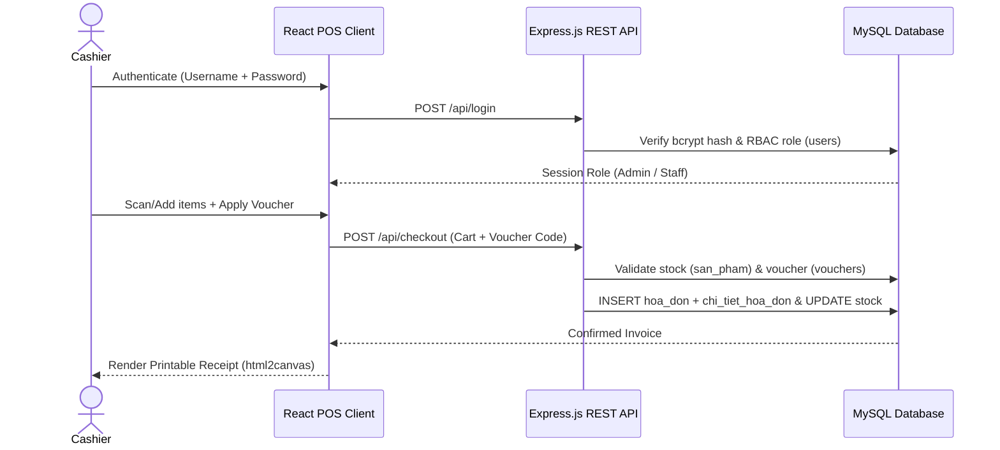

# ThiThiPet POS — Full-Stack Retail Point-of-Sale & Inventory System

[](https://react.dev/)
[](https://expressjs.com/)
[](https://www.mysql.com/)
[-217346?logo=microsoftexcel&logoColor=white)](https://sheetjs.com/)

> **Software Engineering Internship Project** — Built for *ThiThiPet Shop* (Ho Chi Minh City)  
> **Live Developer Portfolio:** [https://minh5499999.github.io/portfolio/](https://minh5499999.github.io/portfolio/) · **Author:** Nguyễn Công Minh (`afk4399@gmail.com`)

**ThiThiPet POS** is an end-to-end Full-Stack Point-of-Sale (POS) and Inventory Management web application engineered specifically for small-to-medium pet supply retail stores. It streamlines cashier checkout, promotional voucher application, real-time stock deduction, digital receipt generation, and Excel financial reporting.

---

## Key Features & Business Impact

- **Fast Cashier POS Checkout (`frontend/src/App.js`):** Category filtering, instant product search, cart quantity controls, promotional voucher validation, and automated change calculation.
- **Real-Time Inventory Synchronization:** Automatically deducts sold quantities from `san_pham` upon invoice creation (`hoa_don` & `chi_tiet_hoa_don`), preventing manual overselling and stock discrepancies.
- **Role-Based Access Control (`Admin` vs. `Cashier`):**
  - Secured with **`bcrypt`** salted password hashing (`backend/server.js`).
  - **Cashiers** access the streamlined billing terminal and receipt printer.
  - **Administrators (`frontend/src/Admin.js`)** manage products (with `multer` image uploads), staff accounts, discount vouchers, order history, and revenue analytics.
- **1-Click Receipt & Excel Financial Export:**
  - Renders downloadable digital/printable receipts directly from the POS screen via **`html2canvas`**.
  - Exports structured multi-row revenue & inventory spreadsheets via **`SheetJS (xlsx)`**.
- **Optimized Static Assets:** Compressed decorative & brand PNG assets by **~80%** (saving 57+ MB) for instant LAN/cloud loading on store terminals.

---

## System Architecture & Checkout Data Flow



---

## Relational Database Schema (`backend/schema.sql`)

| Table Name | Primary Purpose |
| :--- | :--- |
| `users` | Staff & Administrator credentials (`bcrypt` hashed passwords) and RBAC role assignments |
| `san_pham` | Pet food, accessories & healthcare catalog, pricing, image paths, and live stock counts |
| `vouchers` | Promotional discount codes, discount percentages/amounts, usage limits, and validity |
| `hoa_don` | Master sales invoices (timestamp, cashier ID, subtotal, applied discount, final total) |
| `chi_tiet_hoa_don` | Line-item breakdown linking each invoice to sold products, quantities, and unit prices |

---

## Quick Start

### 1. Prerequisites
- **Node.js** `>= 18.x`
- **MySQL** `>= 8.0`

### 2. Configure & Start Backend API (`Port 5000`)
```bash
git clone https://github.com/minh5499999/thithipet-pos-fullstack.git
cd thithipet-pos-fullstack/backend
npm install
cp .env.example .env
```
Import `backend/schema.sql` into MySQL (`thithipet_pos`), optionally seed sample data (`node seed.js`), update `.env` with your MySQL password, and run:
```bash
npm start
```

### 3. Start React POS Frontend (`Port 3000`)
```bash
cd ../frontend
npm install
npm start
```
Open [http://localhost:3000](http://localhost:3000) to launch the POS terminal.

---

## Author

**Nguyễn Công Minh** — Full-Stack Web Developer (React / Next.js · Node.js · MySQL)  
- Portfolio: [minh5499999.github.io/portfolio](https://minh5499999.github.io/portfolio/)  
- GitHub: [@minh5499999](https://github.com/minh5499999)  
- Email: [afk4399@gmail.com](mailto:afk4399@gmail.com)
